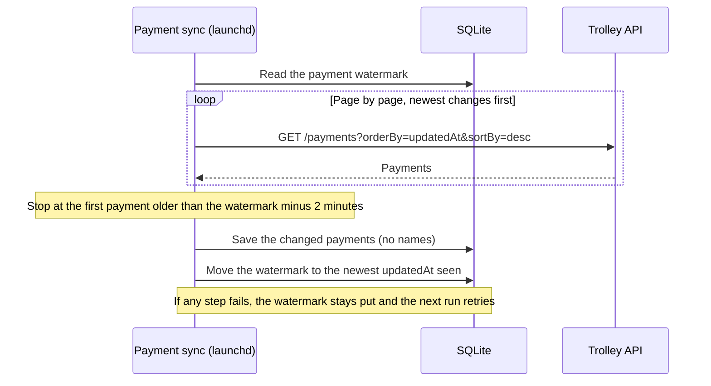

# Internals

Notes on how the plugin works under the hood. The [README](../README.md) covers setup and use.

## One payment sync run

Each hourly run reads only what changed since the watermark. The watermark only moves after the changes are saved.

## Tools (23)
One `<resource>_read` and one `<resource>_write` tool per resource, each with an `action` enum:
recipients, recipient_accounts, batches, payments, offline_payments, invoices, invoice_payments, balances, verifications, webhooks, reference (read only), partner.

**Why this layout:** 80 tiny tools would make `tools/list` unreadable. One tool per resource can't carry honest MCP annotations, because it would mix reads and deletes. A read/write split gives 22 tools: every `_read` tool is `readOnlyHint:true`, and every `_write` tool is `destructiveHint:true`.

Common args: ids (`recipientId`, `batchId`, `paymentId`, `accountId`, `offlinePaymentId`, `subscriptionId`, `countryCode`, `payoutMethod`; prefixes validated), `query` (filters), `body` (JSON body per docs), `page`/`pageSize`, `all`/`maxPages`, `raw`, `confirm`.

## Local store (SQLite) — sync_cache, payout_stats, payout_query
- **File:** `TROLLEY_DB_PATH` (default `~/.cache/trolley-plugin/trolley.db`). There's one file per environment: `trolley-<sha256(accessKey)[:12]>.db`, so sandbox and prod never mix. The key itself is never stored. Files are 0600 in a 0700 directory, using WAL.
- **Schema (no PII):** no names, emails, recipient ids, addresses, memos or account details.
  - `batches(id PK, status, tags JSON, amount, currency, totalPayments, createdAt, sentAt, completedAt, updatedAt, returnedCount, lastSyncedAt)`
  - `payments(id PK, batchId FK, status, sourceAmount, sourceCurrency, targetAmount, targetCurrency, fees, payoutMethod, country, createdAt, processedAt, returnedAt, settledAt, updatedAt, failureReason, returnReason, lastSyncedAt)`
  - Reason columns hold short error codes only.
- **Refresh** (shared by `sync_cache` and `payout_stats`; GET only):
  1. List all batches (pageSize 1000) and upsert them. Batches no longer listed are removed.
  2. Non-terminal batches (anything except `complete`/`failed`) always get a full payment refetch.
  3. Terminal batches completed less than `TROLLEY_FINAL_AFTER_DAYS` ago (default 120) get one cheap call: `GET /batches/:id/payments?status=returned&pageSize=1`. If `meta.records` differs from the stored `returnedCount`, or the batch was never synced, or its `updatedAt`/status changed, it's refetched. This check exists because Trolley does **not** bump batch `updatedAt` when a payment is returned later; in prod a third of returns arrived 1–11 weeks after completion.
  4. Older terminal batches are synced once, then treated as final. `full:true` checks them too, and `force:true` refetches everything.
  - Each batch is replaced in one transaction, upserting by payment id and dropping deleted payments, so runs are idempotent.
- **`payout_stats`:** refreshes (unless `skipRefresh`), then computes from SQL with exact decimal sums. Output includes `refresh` (calls, refetched, checked, changed) and `dataAsOf`.
- **`payout_query`:** read-only SQL over the store. Safeguards:
  - Only a single `SELECT`/`WITH` statement is accepted. `PRAGMA`, `ATTACH`, writes and transaction keywords are rejected by a text guard.
  - The DB is opened `readOnly`, and an SQLite authorizer allows only SELECT/READ/FUNCTION/RECURSIVE.
  - Rows are capped at 1000. Queries time out after `TROLLEY_QUERY_TIMEOUT_MS` (default 5000) in a child process that is SIGKILLed.
- **Known cost:** every refresh refetches all payments of non-terminal batches. Large processing batches can take many minutes to refresh when Trolley is slow. Use `payout_stats {skipRefresh:true}` for instant answers on already-synced data.
- **Rate limit and concurrency:** `TROLLEY_RATE_LIMIT_PER_MIN` (default 45, cap 2000) and `TROLLEY_CONCURRENCY` (default 4, cap 20), or per call. The token bucket is shared, concurrency halves on repeated 429s, `Retry-After` is honoured, and failed GETs are retried.

## Shapes
- `Payout = { id, recipientId, batchId, status, sourceAmount, sourceCurrency, targetAmount, targetCurrency, fees, memo, processedAt }` (payments; `raw:true` for the full object).
- `RecipientSummary = { id, referenceId, name, email, status, complianceStatus, payoutMethod, country, currency?, createdAt }`.
- `BatchSummary = { id, status, amount, currency, totalPayments, description, tags, createdAt, sentAt, completedAt }` (batch lists).
- Everything else is returned as-is, minus sensitive fields.

## Safety
- `confirm:true` is required for: all deletes, `batches.start_processing` (MONEY), verification trigger/expire, and every partner write. `payments.create/update` also need it when the batch is not `open`. Without it you get a dry run (`{dryRun, wouldCall, body, reason}`) and nothing is sent.
- Rate limits: a 429 is retried up to 3× and honours `Retry-After` (seconds or HTTP-date, capped at 60s). Each attempt is re-signed.

## Auth
`Authorization: prsign <ACCESS_KEY>:<hex HMAC-SHA256(secret, ts\nMETHOD\npath+query\nbody\n)>` plus `X-PR-Timestamp` (must be within 30s of UTC). The exact path+query and body string that are sent are the ones signed.

## Known API quirks (sandbox)
- Updating a recipient account may return a new account id. Use the id from the update response for later calls.
- Deleting a recipient archives it, and archived recipients are hidden from the default list (`query:{status:"archived"}` shows them). Their accounts can't be deleted after archiving.
- `invoice_payments search` requires `invoiceIds` or `paymentIds` in `body`.

## Test
    node --test test/*.test.mjs   (Node >= 22.5)

## Status badges
`statusBadge`/`complianceBadge` (recipient_lookup, payday_summary) is an emoji dot plus inline code, e.g. 🟡 `incomplete`. 🟢 active/processed/completed, 🟡 incomplete/pending/open/awaiting approval, 🔴 blocked/failed/returned/suspended, ⚪ anything else. Raw `status` is unchanged.

### Amounts in payday_summary
`totalAmount` is the sum of the payments' `sourceAmount` (matching the counts). `batchAmount` is Trolley's `batch.amount`, shown alongside with `batchAmountMinusPaymentSum`, `paymentFees` and `paymentTargetSum` for reconciliation. They can differ. Classification uses `TROLLEY_BATCH_GROUPS` (whole words, case-insensitive). The `YYYY-MM` prefix is not the payday month.

`TROLLEY_REQUEST_TIMEOUT_MS` (default 180000) aborts a stuck request; GETs are retried.

## Rate limit
`TROLLEY_RATE_LIMIT` (requests/min, default 100, max 2000) is the main setting. `TROLLEY_RATE_LIMIT_PER_MIN` is an alias; if both are set, `TROLLEY_RATE_LIMIT` wins. A single token bucket covers every Trolley API call: tools, `sync_cache`/cache builds, `payout_stats`, `payday_summary` and `recipient_lookup`. A per-call `rateLimitPerMin` overrides it for sync and stats runs.

## recipient_lookup routing
`R-…` uses `GET /recipients/:id`. Input containing `@` is treated as an email (exact, case-insensitive match). Anything else, including UUIDs, is treated as a reference ID: `GET /recipients?referenceId=` (an exact filter; `search=` is a LIKE prefix match), and the returned `referenceId` must equal the input exactly. If that fails, it falls back to the ID path. `matchedBy` is `id`, `email` or `referenceId`.

`TROLLEY_PAGE_SIZE` (10-1000, default 100) sets the page size for payment listings. Trolley's response time grows with page size: for a large processing batch, 1000-row pages can take minutes while 100-row pages take seconds. Smaller pages fetched in parallel finish sooner. payday_summary uses concurrency of at least 10.

## Recipient cache, sync scopes and /init
- Tables: `recipients(id, referenceId, email, country, payoutMethod, status, complianceStatus, isPhoneVerified 0/1, createdAt, updatedAt, lastSyncedAt)`, `sync_state(key, value)`, plus `payments.recipientId` (an opaque ID, added by an additive migration).
- **Privacy:** storing email is owner-approved. **Names are sensitive**: `name`/`firstName`/`lastName` are stripped from every tool output and never stored. An old `name` column is dropped and the DB VACUUMed on open. Tax, bank, address, phone, DOB and government IDs are never stored. The DB is mode 0600. There is no includeSensitive option.
- `/recipient` shows the ID, email, referenceId and statuses, never a name. Bulk tools (`payout_stats`, `payout_query`, `payday_summary`) output only IDs and counts. `payout_query` can't read `recipients`; use the `recipient_facts` view (no email).
- Lazy fill: any payment `recipientId` missing from `recipients` is fetched with `GET /recipients/:id` (a 404 becomes a `not_found` stub). `sync_cache` fills up to 500 per run.
- Watermark sweep (`sync_cache` scope `recipients` or `all`): `GET /recipients?startDate=<watermark − 2 min>&endDate=<sweep start>&orderBy=updatedAt&sortBy=asc`, pageSize 1000. Only recipients already in the table are upserted (duplicates dedupe to the newest). The watermark moves to the max `updatedAt` seen, or to the sweep start if nothing was returned. That happens in one transaction, only after the whole sweep succeeds. The first run with no watermark just sets it to now.
- `/init` / `sh run.sh backfill`: batches and payments, then every referenced recipient, then the watermark is set to the backfill start. It's idempotent and resumable, prints progress, and is read-only. See skills/init for time estimates.
- `recipient_lookup` routing: UUID → `?referenceId=` (exact). Input containing `@` → `?email=` (exact, case-insensitive). `R-…` → `/recipients/:id`. Anything else → `?search=`: one hit returns it; several return up to 10 candidates plus `count`. Live is tried first; if the live call fails (not a 404), the cached row is returned (`source: "cache"`).

### Recipients phase strategy
Backfill only loads recipients whose IDs appear on cached payments (`SELECT DISTINCT recipientId …`). It picks the cheaper of two strategies:
- per-ID: one `GET /recipients/:id` per missing ID
- bulk: `GET /recipients?pageSize=1000` across all pages, keeping only the referenced IDs. Stored fields are identical and a name is never stored. Completed pages are recorded in `sync_state`, so it resumes.

Bulk is chosen when pages × `TROLLEY_BULK_COST_FACTOR` (default 25, an estimate of how much slower one 1000-row page is than one ID call) < missing IDs. Any referenced ID the bulk listing doesn't return is then fetched by ID.

## Scheduled syncs (launchd, macOS)

- `payment-sync` runs hourly at :07. It walks `GET /v1/payments?orderBy=updatedAt&sortBy=desc` until it passes the payment watermark (`payments.updatedAtWatermark`) minus 2 minutes. It upserts by id (idempotent), and the watermark moves only after a successful run. Every 6 h the same job also checks `status=returned` on each batch created in the last 90 days.
- `recipient-sync` runs at 00:37, 06:37, 12:37 and 18:37 local time. It uses the recipient `updatedAt` watermark (2-minute overlap) and updates cached recipients only. It skips payday days, and the watermark isn't advanced on a skipped day.
- Both jobs honour `syncEnabled`, `paymentCache` and `recipientCache`, and read keys through run.sh. Neither makes AI calls. They share a lock with the backfill (`sync.lock` next to the DB) and skip the run if a backfill process is found.
- Commands:
  - `sh run.sh sync payments|recipients [--dry-run]` runs one sync by hand.
  - `sh run.sh schedule install|uninstall|status [--agent]`: the default is a LaunchDaemon (needs sudo once); `--agent` installs a LaunchAgent instead (only while you're logged in, no sudo).
- Logs: `~/Library/Logs/trolley-plugin/{payment,recipient}-sync.log`, rotated at 1 MB with 5 kept.

## Payday monitor (LaunchAgent, macOS)

- Runs every 15 minutes (:00/:15/:30/:45), but only during a 48-hour window from 00:00 (`TROLLEY_TIMEZONE`, default Australia/Melbourne) on payday: `TROLLEY_PAYDAY_DAY` (default 15), clamped to the month and moved to Monday when it falls on a weekend (no public holidays), plus the following day. Outside the window it exits straight away with no API calls.
- Each run takes one live `GET /batches` (most recent 100, any status). It tracks this cycle's batch for each `TROLLEY_BATCH_GROUPS` group (or every batch in the window if none are set), plus any other batch created in the cycle window.
- Notifies on: a new batch; a move to waiting for approval, approved (processing), complete or failed.
- Stuck alerts (once per batch per day, on both days; day-2 alerts say "day 2"): a configured group's batch missing at 09:00; still waiting for approval at 12:00; still processing at 17:00. Transition and failure-rate alerts fire once across the whole window.
- Failure rate (processing/complete batches): 2 calls per batch (`status=failed` and `status=returned`, `pageSize=1`, read `meta.records`). Warns once when the rate is above `TROLLEY_FAIL_RATE_WARN` (3%) and there are at least `TROLLEY_FAIL_MIN_COUNT` (25). Batches under `TROLLEY_FAIL_SMALL_BATCH_SIZE` (300) payments warn at `TROLLEY_FAIL_SMALL_BATCH_COUNT` (10) or more. Escalates once above `TROLLEY_FAIL_RATE_HIGH` (10%).
- Delivery: macOS notification (osascript) plus `~/Library/Logs/trolley-plugin/payday-monitor.log`. `TROLLEY_NOTIFY_EMAIL` is a placeholder for future email delivery and does nothing yet.
- State: `~/.cache/trolley-plugin/payday-monitor-state.json` (0600). Lock: `payday-monitor.lock`. The on/off switch is `TROLLEY_PAYDAY_MONITOR` (default true).
- `sh run.sh monitor run [--dry-run] [--date YYYY-MM-DD] [--now ISO]` (`--date` uses the current Melbourne time of day on that date), `sh run.sh monitor test-notify`, `sh run.sh schedule install|uninstall|status --monitor`.
- Pause: `TROLLEY_PAYDAY_MONITOR=false` in `~/.zshrc`, or `launchctl bootout gui/$(id -u)/com.trolley-plugin.payday-monitor`. Remove: `sh run.sh schedule uninstall --monitor`.
